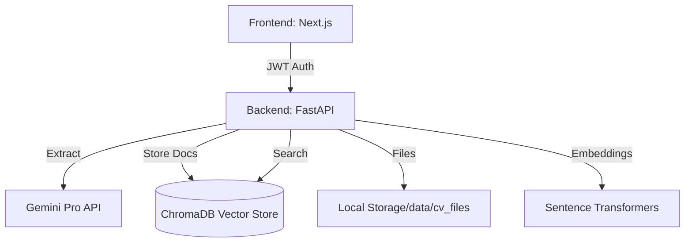

# 🤖 CV AI Platform

[](https://fastapi.tiangolo.com/)
[](https://nextjs.org/)
[](https://www.trychroma.com/)
[](https://deepmind.google/technologies/gemini/)
[](https://opensource.org/licenses/MIT)

**CV AI Platform** is a next-generation recruitment intelligence system. It transforms messy PDF resumes into structured, searchable data using Gemini Pro, provides deep semantic search via vector embeddings, and offers a premium, glassmorphic dashboard for candidate pipeline management.

---

## 📖 Table of Contents
- [Key Features](#-key-features)
- [Architecture](#-architecture)
- [Tech Stack](#-tech-stack)
- [Installation](#-installation)
- [Configuration](#-configuration)
- [Usage Guide](#-usage-guide)
- [API Reference](#-api-reference)
- [Roadmap](#-roadmap)
- [Contributing](#-contributing)
- [License](#-license)

---

## ✨ Key Features

### 📂 Intelligent Ingestion
- **Automated Extraction**: Uses Gemini Pro to extract structured data (Experience, Skills, Education) from any PDF.
- **Duplicate Detection**: SHA-256 hashing ensures no redundant candidate entries.
- **Background Processing**: FastAPI background tasks handle heavy lifting without blocking the UI.

### 🔍 Semantic Search & Retrieval
- **Vector Search**: Search by intent, not just keywords (powered by ChromaDB and Sentence Transformers).
- **Hybrid Scoring**: Combines vector similarity with metadata filtering (Role, Seniority, Industry).
- **Candidate Scoring**: AI-driven match percentages based on job descriptions.

### 📊 Advanced Dashboard
- **Pipeline Management**: Drag-and-drop candidate stages (Applied, Interview, Hired) using `@dnd-kit`.
- **Real-time Analytics**: Interactive charts showing talent distribution and seniority trends using `Recharts`.
- **Proximity UI**: iOS-style glassmorphic design with spring-animated interactions.

### 🔐 Enterprise Security
- **JWT Authentication**: Secure login with role-based access control (Admin vs. Recruiter).
- **Audit Logging**: Every action (ingestion, search, deletion) is tracked.
- **Rate Limiting**: Protects endpoints from abuse using `slowapi`.

---

## 🏗 Architecture



---

## 🛠 Tech Stack

### Frontend
- **Framework**: Next.js 16 (App Router)
- **State Management**: Zustand & TanStack Query
- **Styling**: Tailwind CSS + Shadcn/UI
- **Animations**: Framer Motion
- **Form Handling**: React Hook Form + Zod

### Backend
- **Core**: FastAPI (Python 3.10+)
- **AI/LLM**: Google Gemini Pro (google-genai)
- **Vector DB**: ChromaDB
- **NLP**: Spacy + PyMuPDF
- **Embeddings**: Sentence-Transformers (all-MiniLM-L6-v2)

---

## 🚀 Installation

### 1. Clone the Repository
```bash
git clone https://github.com/your-username/cv-ai.git
cd cv-ai
```

### 2. Backend Setup
```bash
# Create virtual environment
python -m venv venv
source venv/bin/activate  # On Windows use: venv\Scripts\activate

# Install dependencies
pip install -r requirements.txt
```

### 3. Frontend Setup
```bash
cd cv-ai-frontend
npm install
```

---

## ⚙️ Configuration

Create a `.env` file in the root directory:

```env
# API Keys
GOOGLE_API_KEY=your_gemini_api_key

# JWT Settings
JWT_SECRET=your_random_secret_string
JWT_ALGORITHM=HS256
ACCESS_TOKEN_EXPIRE_MINUTES=60

# Database
CHROMA_DB_PATH=chroma_db
```

---

## 🖥 Usage Guide

### Start the API (Backend)
```bash
# From the root directory
python -m uvicorn app.api.main:app --reload --host 0.0.0.0 --port 8000
```
*Docs available at `http://localhost:8000/docs`*

### Start the Dashboard (Frontend)
```bash
cd cv-ai-frontend
npm run dev
```
*Access at `http://localhost:3000`*

---

## 📡 API Reference

| Endpoint | Method | Description | Access |
| :--- | :--- | :--- | :--- |
| `/token` | `POST` | Login & get JWT token | Public |
| `/health` | `GET` | System health & CORS check | Public |
| `/api/ingest` | `POST` | Upload PDF and index | Admin |
| `/api/search` | `POST` | Semantic search | Authenticated |
| `/api/candidates`| `GET` | List all candidates | Authenticated |

---

## 🗺 Roadmap
- [ ] Multi-tenant support for agencies.
- [ ] Direct integration with LinkedIn/Indeed APIs.
- [ ] AI-generated interview question templates.
- [ ] Email automation for candidate rejection/acceptance.

---

## 🤝 Contributing
1. Fork the Project.
2. Create your Feature Branch (`git checkout -b feature/AmazingFeature`).
3. Commit your Changes (`git commit -m 'Add some AmazingFeature'`).
4. Push to the Branch (`git push origin feature/AmazingFeature`).
5. Open a Pull Request.

---

## 📄 License
Distributed under the MIT License. See `LICENSE` for more information.

---

## ✉️ Contact
**Anil Sambyal** - [GitHub](https://github.com/anilsambyal547)

Project Link: [https://github.com/your-username/cv-ai](https://github.com/your-username/cv-ai)
